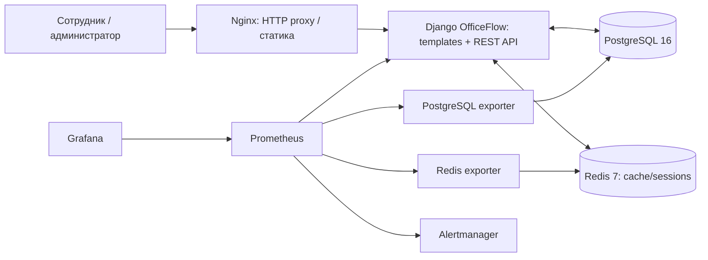
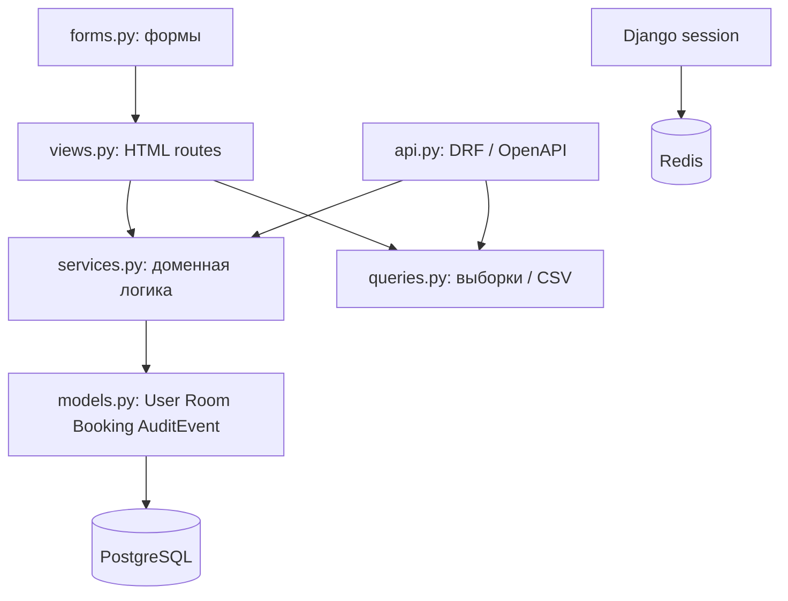
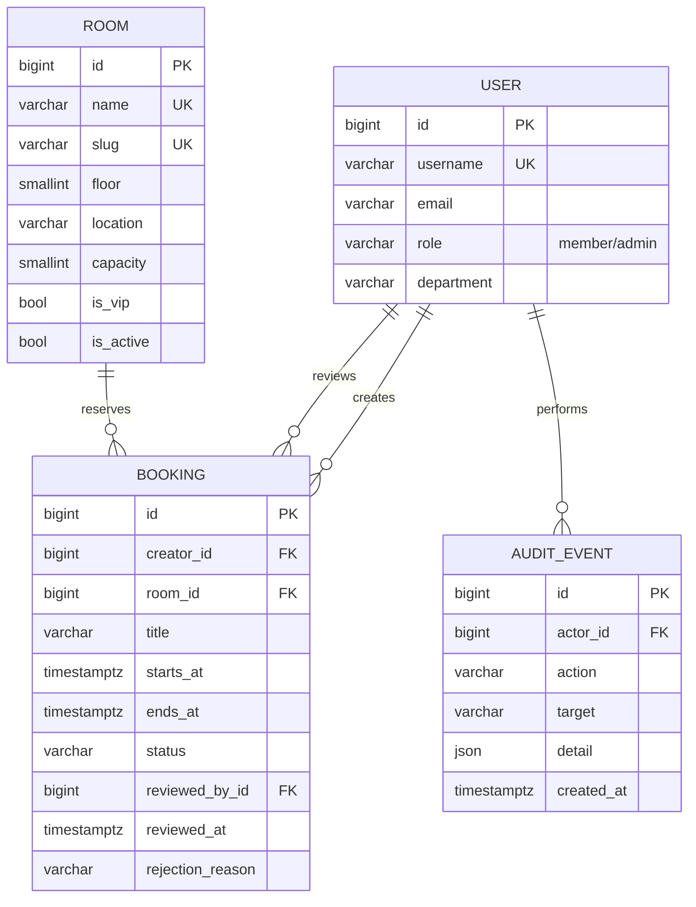
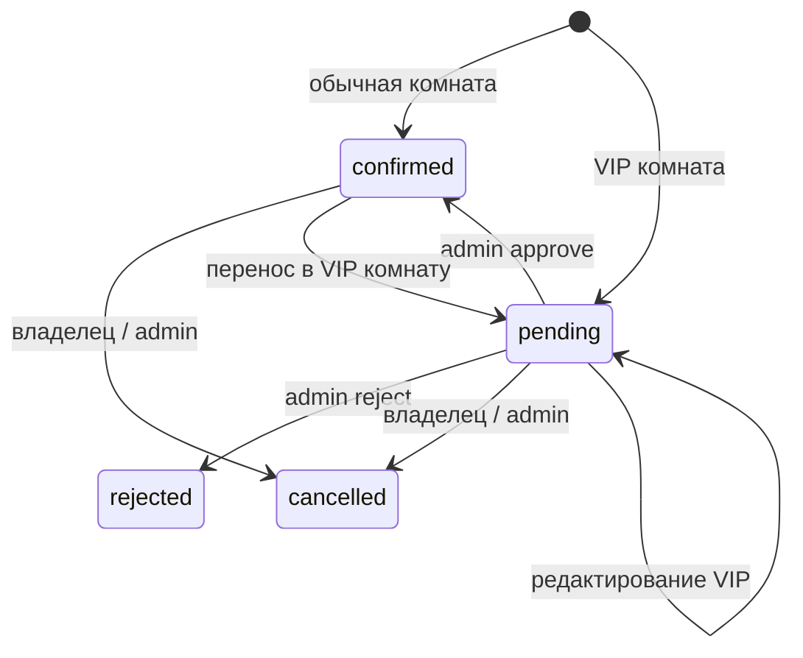

# Архитектура OfficeFlow

## Контекст и обоснование

Две категории пользователей: сотрудник и администратор. Сотрудник просматривает календарь/список комнат и управляет **своими** бронями. Администратор управляет ресурсами, ролями, VIP-заявками и отчётами. История не удаляется при отмене брони.

Выбрана модульная монолитная схема Django: одни бизнес-сервисы применяются в HTML и REST API. Это уменьшает риск расхождения правил и проще для демонстрации, чем набор микросервисов. Все бизнес-переходы выполняются в транзакциях.

## C4 — контейнеры (Mermaid)



### Модули Django



## ER-модель



## Ключевые инварианты

1. Интервалы встречи должны начинаться и заканчиваться на целый час; `1 ≤ duration ≤ 4 часа`; начало в будущем, горизонт не более 180 дней.
2. Интервалы используются как **[start, end)**: конец одной встречи может совпасть с началом следующей.
3. **Активные статусы** `pending` и `confirmed` блокируют комнату. `rejected` и `cancelled` сохраняются в истории, но слот освобождают.
4. Для VIP сервер сам устанавливает `pending`; пользователь не может послать `confirmed` в API и обойти согласование.
5. Изменять и отменять запись может её автор либо администратор; просматривать чужую бронь по REST ID сотрудник не может.
6. Переплетение параллельных транзакций предотвращают блокировка `Room SELECT ... FOR UPDATE` и независимое ограничение PostgreSQL:

```sql
CREATE EXTENSION IF NOT EXISTS btree_gist;
ALTER TABLE workspace_booking
ADD CONSTRAINT booking_room_no_overlap
EXCLUDE USING GIST (
    room_id WITH =,
    tstzrange(starts_at, ends_at, '[)') WITH &&
) WHERE (status IN ('confirmed', 'pending'));
```

7. Бронирования создаются/изменяются через `services.py`. Django Admin не разрешает ручное изменение/удаление `Booking`: это исключает обход согласования через админку.
8. Отчёты и экспорт доступны только администратору, формулы CSV экранируются от spreadsheet injection.
9. Логика интерфейса и API пользуется общим сервисным слоем; JavaScript не является источником бизнес-ограничений.

## Модель переходов состояния



Редактирование подтверждённой брони в обычной комнате оставляет `confirmed`. Повторное рассмотрение VIP отклоняется. `reviewed_by`, `reviewed_at`, `rejection_reason` и `AuditEvent` позволяют восстановить историю действий.

## API, версия v1

Вся предметная часть требует сеанс Django. Для запросов сессии из браузера работает CSRF. Административные методы возвращают 403 для обычных пользователей.

| Метод | URL | Описание | Роль |
|---|---|---|---|
| GET | `/api/v1/rooms/` | Доступные переговорные | user |
| GET | `/api/v1/rooms/{id}/` | Карточка | user |
| POST/PATCH | `/api/v1/rooms/`, `/api/v1/rooms/{id}/` | Создание/обновление | admin |
| DELETE | `/api/v1/rooms/{id}/` | Деактивация без удаления истории | admin |
| GET | `/api/v1/schedule/?date=YYYY-MM-DD` | Расписание на 7 дней; только поля, необходимые календарю (без заметок и идентификаторов автора) | user |
| GET | `/api/v1/bookings/` | История (своя, у админа — общая) | user |
| POST | `/api/v1/bookings/` | Создание | user |
| PUT/PATCH | `/api/v1/bookings/{id}/` | Изменение | owner/admin |
| POST | `/api/v1/bookings/{id}/cancel/` | Отмена | owner/admin |
| POST | `/api/v1/bookings/{id}/approve/` | VIP-одобрение | admin |
| POST | `/api/v1/bookings/{id}/reject/` | VIP-отклонение | admin |
| GET | `/api/v1/users/` | Пользователи | admin |
| POST | `/api/v1/users/{id}/change_role/` | Роль | admin |
| GET | `/api/v1/reports/summary/` | Сводка | admin |
| GET | `/api/v1/reports/export.csv?from=&to=&room=` | CSV | admin |
| GET | `/api/schema/`, `/api/docs/` | OpenAPI и Swagger | web (настройка доступа для deployment) |
| GET | `/health/live/`, `/health/ready/` | Health endpoints | public |

Пример `POST /api/v1/bookings/`:

```json
{
  "room": 1,
  "title": "Планирование спринта",
  "notes": "Подготовить повестку",
  "starts_at": "2026-12-01T10:00:00+03:00",
  "ends_at": "2026-12-01T12:00:00+03:00"
}
```

Ответ `201` с ID и назначенным сервером `status`; ошибки: `400` некорректное время, `403` недостаточно прав, `404` чужая запись/несуществующая, `409` конфликт доступности/перехода статуса. В примере дата приводится только для иллюстрации формата; actual request должен быть в будущем.


Расписание доступно всем авторизованным сотрудникам, поэтому API возвращает только календарные поля брони: ID, комнату, тему, интервал и статус. Внутренние заметки, автор, данные согласования и причина отклонения доступны только через персональную историю владельца или административные сценарии.

### Временные зоны

Django `USE_TZ=True`; PostgreSQL хранит `timestamptz` с нормализацией, формы отображают `TIME_ZONE=Europe/Moscow` по умолчанию. Для организаций в нескольких зонах необходимо расширить профиль пользователя с персональным часовым поясом и проверить переходы DST отдельными тестами.

### Изоляция от другого проекта

Свой Compose project `officeflow`, отдельные named volumes, собственные пользовательские роли, схема URL, интерфейс и навигация. Не используется исходный код, изображения, CSS или миграции MeetingRoomBooking.
